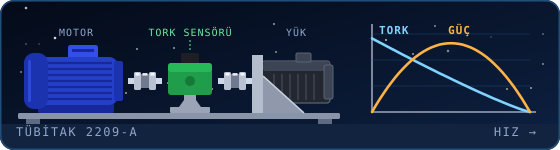

  

<a href="./README.md">🇹🇷 Türkçe</a> · 🇬🇧 English

---

### 👨‍🚀 About Me

I hold a B.Sc. in Mechatronics Engineering and am currently pursuing an **M.Sc. in Electrical Engineering** at Kocaeli University. Starting in 2021, I served as the Avionics Subsystem Lead and Team Captain of the **KOUSPACE** rocketry team, and I now advise the team as a mentor.

I worked across the full hardware and firmware lifecycle—from flight computer schematics and PCB layout to embedded software, prototype assembly, and pre-flight testing. Previously, I completed internships in model-based software (Simulink/Stateflow, CAN) at **Musoshi** and embedded software & hardware at **Asis Automation**.

---

### 🚀 Rockets & Projects

<table>
<tr>
<td width="50%" valign="top">

#### 🚀 Medium-Altitude Rocket
🏆 **TEKNOFEST 2023 · 5th Place**

- ESP32-based **4-layer flight control computer**
- Sensor, communication, and recovery circuit design
- Autonomous separation algorithms and **LoRa telemetry**

</td>
<td width="50%" valign="top">

#### 🛬 Vertical Landing Rocket
🏆 **TEKNOFEST 2025 & 2026 · 4th Place**

- STM32-based **4-layer control board** (IMU + LiDAR)
- Servo-actuated **proportional needle valve** for **4-thruster cold-gas** propulsion
- Industrial servo drive control via **Modbus RTU**

</td>
</tr>
<tr>
<td width="50%" valign="top">

#### 🔥 Hybrid Rocket Motor

- Power distribution and valve driver stages for static test stand
- Remote **safe ignition** control
- **RS-485 DAQ** for load cell, pressure, and temperature data

</td>
<td width="50%" valign="top">

#### ⚙️ Electric Motor Test Bench
🎓 **Senior Thesis · TÜBİTAK 2209-A**

- Torque, speed, and power characterization with torque sensor and load motor
- Schematic/PCB design and embedded firmware for the DAQ board
- Real-time measurement and test data logging

</td>
</tr>
</table>

---

### 🛠️ Toolbox

         

