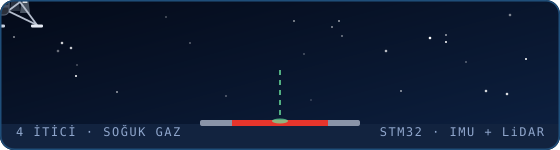
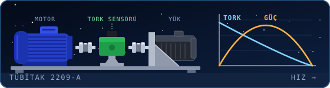

 

---

### 👨‍🚀 Hakkımda

Mekatronik Mühendisliği lisans mezunuyum, Kocaeli Üniversitesi'nde **Elektrik Mühendisliği yüksek lisansı** yapıyorum. 2021'den beri **KOUSPACE** roket takımında aviyonik alt sistem sorumlusu ve takım kaptanıyım. Uçuş kontrol bilgisayarlarının şematiğinden gömülü yazılımına, prototip üretiminden uçuş öncesi testlerine kadar sürecin içindeyim. Musoshi'de model tabanlı yazılım (Simulink/Stateflow, CAN), Asis Otomasyon'da gömülü yazılım ve donanım stajı yaptım.

---

### 🚀 Roketler ve Projeler

<table>
<tr>
<td width="50%" valign="top">

#### 🚀 Orta İrtifa Roketi
🏆 **TEKNOFEST 2023 · Beşincilik**

- ESP32 tabanlı **4 katmanlı uçuş kontrol bilgisayarı**
- Sensör, haberleşme ve kurtarma devreleri
- Otonom ayrılma algoritmaları
- **LoRa** tabanlı telemetri

</td>
<td width="50%" valign="top">

#### 🛬 Dikey İnişli Roket
🏆 **TEKNOFEST 2025 ve 2026 · Dördüncülük**

- STM32 tabanlı **4 katmanlı kontrol kartı** (IMU + LiDAR)
- **4 iticili soğuk gaz** itki için servo tahrikli **oransal iğneli valf**
- **Modbus RTU** ile endüstriyel servo sürücü kontrolü

</td>
</tr>
<tr>
<td width="50%" valign="top">

#### 🔥 Hibrit Yakıtlı Roket Motoru

- Statik ateşleme için güç dağıtımı ve valf sürüş devreleri
- Uzaktan **güvenli ateşleme** devresi
- Load cell, basınç ve sıcaklık verisi için **RS-485 DAQ**

</td>
<td width="50%" valign="top">

#### ⚙️ Elektrik Motoru Test Düzeneği
🎓 **Bitirme Projesi · TÜBİTAK 2209-A**

- Yük altında tork, hız ve güç eğrisi karakterizasyonu
- DAQ kartının şematik/PCB tasarımı ve gömülü yazılımı

</td>
</tr>
</table>

---

### 🛠️ Araç Kutusu

         

